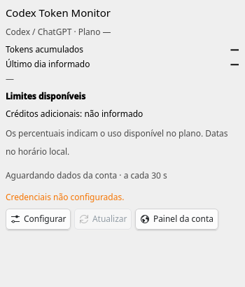
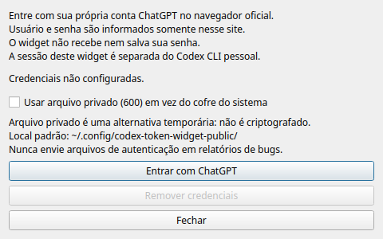

# Codex Token Monitor

Monitor de uso e limites do Codex para KDE Plasma (Linux/Fedora) e Windows 11.

No Windows, mostra `5H 82% | 7D 97%` sobre a barra de tarefas, à esquerda dos ícones do sistema, com atualização a cada 15 segundos, fonte suavizada, três tamanhos e seleção de cores. O login pertence somente ao widget e usa o cofre de credenciais do Windows.

## Windows 11

Requisitos: Node.js e Codex CLI (`npm install -g @openai/codex`). Baixe o código em **Code → Download ZIP**, extraia e, na pasta `windows`, execute:

```powershell
powershell -NoProfile -ExecutionPolicy Bypass -File .\install.ps1
```

Clique no texto para abrir o painel e use **Entrar com ChatGPT**. Cada usuário precisa fazer seu próprio login. [Instruções completas, privacidade e limitações da versão Windows](windows/README.md).

A instalação não altera idioma, teclado nem ícones de outros aplicativos. O perfil privado fica em `%LOCALAPPDATA%\CodexTokenMonitor\profile`, fora desta árvore pública; não compartilhe nem versione essa pasta.

## Linux / Fedora KDE

**Este projeto não inclui credenciais, contas ou tokens do autor. Cada usuário deve configurar suas próprias credenciais.**



## Recursos

- Limites disponíveis das janelas de uso e da semana, com datas de renovação locais.
- Tokens acumulados e último dia informado, quando disponíveis no Codex CLI.
- Representação compacta para painel e detalhada para desktop.
- Atualização dos dados a cada 30 segundos no Linux e 15 segundos após cada consulta no Windows, com atualização manual.
- Login oficial do ChatGPT pelo navegador, sessão exclusiva do widget e remoção de credenciais.
- Sem tentativas de autenticação quando nenhuma conta foi configurada.

## Requisitos

- KDE Plasma 6 com `kpackagetool6` e o módulo `org.kde.plasma.plasma5support`.
- Python 3, PySide6, `xdg-open` e Codex CLI no `PATH`.
- Conta ChatGPT com acesso aos limites consultados, internet e navegador.
- Cofre do sistema compatível com o armazenamento `keyring` do Codex, ou escolha explícita do arquivo privado.

Instalação e renderização verificadas no Fedora 44 KDE, Plasma 6.7.5, Python 3.14, PySide6/Qt 6.11.2 e Codex CLI 0.160.0. Autenticação real pelo navegador, atualização, persistência após reiniciar o Plasma e remoção da sessão do cofre também foram verificadas; veja [o relatório](docs/LOCAL_REVIEW.md).

No Fedora, PySide6 é fornecido pelo pacote `python3-pyside6`. Instale o Codex CLI conforme a [documentação oficial](https://learn.chatgpt.com/docs/cli).

## Instalação

Na pasta do projeto:

```bash
./install.sh
```

O script instala ou atualiza apenas `io.github.poajefersonld1983.codex-token-monitor`. Não pede credenciais, modifica painéis nem importa sessões existentes. Adicione **Codex Token Monitor** ao painel ou desktop pelo seletor de widgets do Plasma.

A instalação não substitui widgets que tenham outro identificador.

## Configuração e login

1. Na primeira execução aparece **Credenciais não configuradas.** Clique em **Configurar**.
2. Mantenha o cofre do sistema selecionado. Se não estiver disponível, escolha explicitamente **Usar arquivo privado (600) em vez do cofre do sistema**.
3. Clique em **Entrar com ChatGPT**. Informe seu próprio login e senha somente na página oficial aberta pelo navegador; conclua MFA e autorização, se solicitados.
4. Aguarde **Authentication successful**. A sessão é salva automaticamente; feche a janela.

Também é possível abrir o diálogo em **Configurações do widget → Conta e privacidade**.

O Codex não oferece autenticação por usuário/senha via RPC. Por isso a interface usa OAuth em vez de receber uma senha no widget. O controle de exibição da senha pertence à página oficial. Não há arquivo de exemplo de credenciais, campos preenchidos nem conta padrão.



### Alterar conta / sair

Clique em **Configurar → Remover credenciais**. O widget remove sua própria sessão do cofre escolhido e os arquivos do seu perfil exclusivo, limpa os dados exibidos e volta ao estado inicial. Não remove a instalação nem a sessão pessoal do Codex CLI. Depois, use **Entrar com ChatGPT** para conectar outra conta.

Se o cofre estiver bloqueado ou indisponível, a remoção pode falhar: desbloqueie-o e tente novamente. Uma mensagem de falha não confirma remoção. A sessão do navegador e outras sessões ChatGPT não são encerradas pelo widget.

## Desinstalação

```bash
./uninstall.sh
```

O script remove apenas o widget. Nenhuma configuração, credencial ou sessão pessoal é apagada automaticamente. Para remover a autenticação, use **Remover credenciais** antes de desinstalar.

Arquivos exclusivos do widget ficam em `${XDG_CONFIG_HOME:-~/.config}/codex-token-widget-public/`. Podem ser apagados manualmente após remover a sessão do cofre. Apagar essa pasta não remove por si só uma entrada do cofre. Nunca apague `~/.codex` para desinstalar este widget.

## Privacy and Security

- O widget não distribui credenciais do desenvolvedor. Cada usuário usa sua própria conta.
- Credenciais não são enviadas para o GitHub. O widget não faz chamadas ao GitHub; a autenticação e as consultas são feitas pelo Codex nos serviços da OpenAI.
- O login acontece no navegador oficial. O widget não recebe nem registra a senha.
- O padrão é `cli_auth_credentials_store="keyring"`, delegado ao Codex e ao cofre do sistema. Não existe fallback automático para texto puro.
- A alternativa explícita `file` salva os tokens em `${XDG_CONFIG_HOME:-~/.config}/codex-token-widget-public/codex/auth.json`, fora do código e do plasmoid, com permissão `600`; diretórios privados usam `700`. O arquivo não é criptografado e deve ser tratado como uma senha. Backups pessoais também precisam protegê-lo.
- Configurações não secretas e cache de métricas usam `settings.json` e `status.json` na mesma pasta privada. O perfil do Codex pode criar outros arquivos locais nessa pasta. Nada desse perfil é incluído no pacote ou repositório.
- O widget usa um `CODEX_HOME` próprio e uma lista restrita de variáveis de ambiente. Não importa `~/.codex`, API keys, tokens ou o estado de versões antigas.
- Respostas completas, headers, cookies, tokens e URLs temporárias de autenticação não são registrados nem exibidos em mensagens de debug. A saída de diagnóstico do subprocesso é descartada; logging Rust e telemetria são desativados no ambiente do widget.
- Arquivos locais contendo autenticação não devem ser versionados. O `.gitignore` bloqueia autenticação, caches, bancos, logs e artefatos de build; isso complementa, mas não substitui, revisão de conteúdo.

**As credenciais nunca devem ser incluídas em issues, logs ou relatórios de bugs.** Não anexe perfis do navegador, pastas de estado, `auth.json`, cookies, tokens ou respostas completas do servidor. Screenshots devem ser revisados antes de compartilhar.

## Limitações conhecidas

- Login por usuário/senha dentro do widget não é suportado pelo protocolo do Codex; é usado OAuth oficial. O fluxo funcional foi testado pelo mantenedor durante a preparação local.
- O app-server do Codex evolui. Consultas como `account/usage/read` podem não existir em outra versão ou plano; nesses casos os tokens aparecem indisponíveis, mesmo que os limites funcionem.
- Percentuais representam limites do plano, não créditos de API nem contagem de tokens em tempo real.
- O fluxo real com o cofre foi validado nesta máquina. Outros cofres/distribuições e autenticação real no modo arquivo privado ainda precisam de validação nos respectivos ambientes.
- Sem internet ou com sessão expirada, é exibida uma mensagem genérica. Uma sessão expirada identificada bloqueia novas consultas até reconfigurar.
- Cada leitura ativa do app-server pode renovar uma sessão gerenciada. Um serviço remoto pode exigir nova autorização ou impor restrições de conta.
- Este é um projeto independente; não é um produto oficial da OpenAI ou do KDE.

## Licença

MIT para o código do widget. Dependências externas mantêm suas licenças e não são redistribuídas. Veja [LICENSE](LICENSE) e [a revisão de procedência](docs/LICENSING.md).

## Desenvolvimento

```bash
PYTHONDONTWRITEBYTECODE=1 python3 -m unittest discover -s tests -v
python3 tools/check_public_tree.py
python3 -B tools/build_package.py
```

O pacote é gerado em `dist/Codex-Token-Monitor-1.0.0.plasmoid`, somente a partir dos arquivos públicos. Não execute testes com credenciais reais em fixtures. Os testes offline usam estado temporário e respostas sintéticas; não comprovam autenticação de uma conta real.

Antes de publicar, execute o [roteiro de testes manuais](docs/TESTING.md), revise os resultados e rode a busca de segredos tanto na árvore quanto no pacote. Não importe histórico Git de versões pessoais.

## Contribuição

Propostas de correção e melhoria são bem-vindas. Inclua versão do Plasma, distribuição, versão do Codex e passos mínimos de reprodução. Use somente dados sintéticos; revise patches e screenshots para remover informações pessoais. Mudanças no fluxo de autenticação devem preservar isolamento, erros sanitizados e logout. O código público está no repositório indicado na metadata. Cada instalação usa a conta e as credenciais do próprio usuário.
